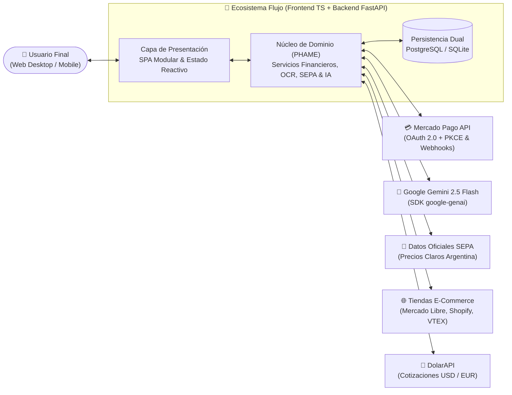
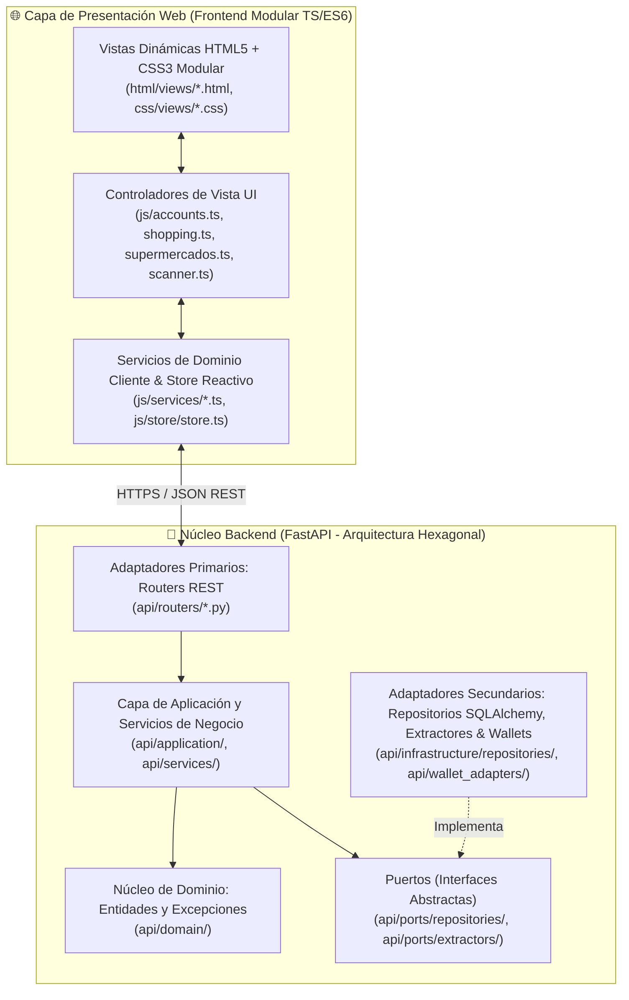

# Documento de Visión (Estándar IBM RUP): Sistema de Gestión Inteligente de Finanzas Personales y Optimización de Consumo ("Flujo")

| Metadatos del Documento | Detalle |
| :--- | :--- |
| **Proyecto** | Flujo — Ecosistema de Gestión Financiera, IA & Comparador SEPA |
| **Estándar de Ingeniería** | Plantilla Oficial de Documento de Visión **IBM Rational Unified Process (RUP)** |
| **Versión** | 3.0 (Sincronizada con Arquitectura Productiva SOLID & PHAME) |
| **Fecha de Emisión** | 26 de Octubre de 2026 |
| **Estado** | **Aprobado / En Producción** |

---

## Historial de Revisiones

| Fecha | Versión | Descripción | Autor |
| :--- | :---: | :--- | :--- |
| Mayo 2026 | 1.0 | Concepción inicial del alcance (Prototipo conceptual móvil y OCR básico). | Equipo de Desarrollo |
| Junio 2026 | 2.0 | Migración a Plataforma Web Full-Stack, integración con Google Gemini 2.5 Flash, OAuth 2.0 con Mercado Pago y cifrado Fernet. | Equipo de Desarrollo |
| Octubre 2026 | **3.0** | **Alineación integral con el estándar IBM RUP**: Incorporación de Arquitectura Hexagonal (PHAME) y SOLID, Motor de Precios Claros (SEPA), Simulador Financiero E-Commerce (VPN / Cuotas vs. Inflación), Gestión Patrimonial Multidivisa y Asistente IA con *Function Calling*. | Equipo de Arquitectura y Desarrollo |

---

## 1. Introducción

### 1.1. Propósito del Documento
El propósito de este **Documento de Visión**, estructurado bajo los lineamientos de ingeniería de software de **IBM Rational Unified Process (RUP)**, es recopilar, analizar y definir las necesidades de alto nivel, las características arquitectónicas y los casos de uso fundamentales del sistema **Flujo**. Se centra en las capacidades requeridas por los interesados (*stakeholders*) y los usuarios finales, justificando el porqué de estas necesidades y estableciendo cómo el sistema las satisface mediante una arquitectura limpia (**PHAME / Hexagonal**) y principios **SOLID**.

### 1.2. Alcance del Sistema
El proyecto **Flujo** consiste en una **Plataforma Web Full-Stack 100% Responsive (PWA)** respaldada por una API RESTful de alto rendimiento en Python (**FastAPI**). El sistema aborda integralmente el ciclo financiero del ciudadano moderno en economías dinámicas e inflacionarias:
1. **Gestión Patrimonial y Contable Multidivisa (`ARS`, `USD`, `EUR`):** Control unificado de cuentas bancarias, billeteras virtuales y efectivo, con transferencias bimonetarias en tiempo real conectadas a cotizaciones de mercado.
2. **Automatización mediante OCR Híbrido + IA Generativa:** Digitalización instantánea de tickets y facturas combinando preprocesamiento óptico en cliente (**Tesseract.js**) con interpretación contextual y estructuración JSON mediante **Google Gemini 2.5 Flash**.
3. **Optimización de Compras en Supermercados (Motor SEPA):** Comparador geolocalizado de precios minoristas conectado a los datos abiertos oficiales del Estado (**SEPA / Precios Claros**), con lector de código de barras en góndola (`BarcodeDetector`) y optimizador de canasta familiar completa (*Split Shopping*).
4. **Simulador Financiero E-Commerce ("Cuotas vs. Inflación"):** Motor matemático de evaluación de compras en línea (Mercado Libre y tiendas web universales) que calcula el **Valor Presente Neto (VPN)**, **TNA de Indiferencia**, días de gracia según cierre de tarjeta y topes de reintegro bancario.
5. **Conectividad Open Finance & Billeteras Virtuales:** Sincronización automatizada con **Mercado Pago** vía protocolo **OAuth 2.0 + PKCE** y recepción de notificaciones en tiempo real mediante **Webhooks HMAC**.
6. **Inteligencia Artificial Conversacional (*Function Calling*):** Asistente financiero flotante e *IA Insights* capaces de auditar presupuestos, detectar desvíos y ejecutar transacciones directamente sobre la base de datos.

### 1.3. Definiciones, Acrónimos y Abreviaturas
* **RUP (*Rational Unified Process*):** Marco de trabajo de procesos de ingeniería de software desarrollado por IBM Rational.
* **PHAME / Arquitectura Hexagonal:** Patrón arquitectónico de *Puertos y Adaptadores* que aísla la lógica de dominio de la infraestructura externa (bases de datos, frameworks web y APIs de terceros).
* **SOLID:** Conjunto de cinco principios de diseño orientado a objetos que garantizan alta cohesión, bajo acoplamiento y mantenibilidad de clase mundial.
* **SEPA:** *Sistema Electrónico de Publicidad de Precios Argentinos*, base de datos gubernamental de precios minoristas reportados diariamente por hipermercados.
* **OCR (*Optical Character Recognition*):** Reconocimiento Óptico de Caracteres aplicado a comprobantes fiscales y tickets de compra.
* **VPN (*Valor Presente Neto*):** Métrica financiera que descuenta flujos de caja futuros (cuotas) a una Tasa Efectiva Mensual (TEM) de inflación o rendimiento para compararlos contra el precio de contado.
* **PKCE (*Proof Key for Code Exchange*):** Extensión de seguridad para OAuth 2.0 que previene ataques de interceptación de códigos de autorización.
* **Fernet (AES-128-CBC + HMAC-SHA256):** Especificación criptográfica simétrica autenticada utilizada para el cifrado de tokens sensibles en reposo.

### 1.4. Referencias Técnicas del Proyecto
* Documentación de Organización y Arquitectura: [`mds/organizacion.md`](file:///h:/Gestor%20de%20Finanzas/mds/organizacion.md)
* Plan Integral de Mejora OCR + IA Gemini: [`mds/OCR_IMPROVEMENT_PLAN.md`](file:///h:/Gestor%20de%20Finanzas/mds/OCR_IMPROVEMENT_PLAN.md)
* Arquitectura de IA Insights y *Function Calling*: [`mds/ia_insights_y_seguridad.md`](file:///h:/Gestor%20de%20Finanzas/mds/ia_insights_y_seguridad.md)
* Seguridad de Tokens y Criptografía Fernet: [`mds/seguridad_tokens.md`](file:///h:/Gestor%20de%20Finanzas/mds/seguridad_tokens.md)
* Sincronización OAuth 2.0 y Webhooks de Billeteras: [`mds/sincronizacion_billeteras.md`](file:///h:/Gestor%20de%20Finanzas/mds/sincronizacion_billeteras.md)
* Motor de Recomendación de Compras y Extractores Semánticos: [`mds/recomendacion_compras.md`](file:///h:/Gestor%20de%20Finanzas/mds/recomendacion_compras.md)
* Auditoría y Arquitectura del Buscador SEPA: [`mds/analisis_seccion_buscador_sepa.md`](file:///h:/Gestor%20de%20Finanzas/mds/analisis_seccion_buscador_sepa.md)

---

## 2. Posicionamiento

### 2.1. Oportunidad de Negocio
En contextos de alta volatilidad nominal, dispersión de precios entre cadenas comerciales y fragmentación de medios de pago (múltiples billeteras virtuales, tarjetas bancarias con topes de reintegro complejos y planes de financiación con o sin interés), los usuarios sufren una pérdida sistemática de poder adquisitivo. Las aplicaciones tradicionales se limitan a actuar como "planillas pasivas de registro post-gasto": informan en qué se gastó el dinero cuando ya es demasiado tarde, pero no asisten en el momento crítico previo a la decisión de compra.

### 2.2. Sentencia de Definición del Problema (Formato IBM RUP)

| Elemento | Descripción |
| :--- | :--- |
| **El problema de** | La fragmentación financiera en múltiples cuentas/divisas, la fricción del registro manual de gastos, la alta dispersión de precios en supermercados y la complejidad matemática para evaluar cuotas frente a la inflación. |
| **Afecta a** | Individuos, estudiantes, profesionales y familias que administran presupuestos domésticos y realizan compras cotidianas o bienes durables. |
| **El impacto asociado es** | Pérdida de poder adquisitivo real, sobreendeudamiento no planificado, abandono prematuro del registro contable por fatiga de carga y desaprovechamiento de promociones bancarias o arbitrajes financieros. |
| **Una solución exitosa sería** | Una plataforma unificada e inteligente que automatice la ingesta de gastos (vía OCR+IA y sincronización OAuth con billeteras), optimice el changuito de supermercado con datos oficiales geolocalizados (SEPA) y calcule matemáticamente el medio de pago óptimo antes de cada compra. |

### 2.3. Sentencia de Posicionamiento del Producto (Formato IBM RUP)

| Elemento | Descripción |
| :--- | :--- |
| **Para** | Consumidores y ahorristas que buscan el control total de su patrimonio y la máxima eficiencia en cada decisión de compra. |
| **Que** | Necesitan centralizar sus cuentas multidivisa, eliminar la carga manual de comprobantes y proteger su ingreso frente a la inflación y la dispersión de precios. |
| **Flujo es** | Un ecosistema Fintech Web Full-Stack impulsado por Inteligencia Artificial y motores de cálculo financiero y geoespacial. |
| **Que** | Automatiza la contabilidad personal mediante visión artificial y conexión directa con billeteras virtuales, mientras audita precios de supermercados (SEPA) y simula el Valor Presente Neto (VPN) de compras en cuotas en cualquier comercio electrónico. |
| **A diferencia de** | Los gestores de gastos tradicionales (que solo registran erogaciones pasadas de forma manual) o los comparadores aislados que desconocen el saldo y las tarjetas del usuario. |
| **Nuestro producto** | Conecta en tiempo real el patrimonio disponible, las tarjetas registradas y los presupuestos del usuario con la inteligencia de precios del mercado para recomendar la acción financieramente óptima en un solo clic. |

---

## 3. Descripciones de los Interesados (Stakeholders) y Usuarios

### 3.1. Resumen de los Interesados (Stakeholders)

| Nombre / Rol | Descripción | Responsabilidades Principales |
| :--- | :--- | :--- |
| **Product Owner / Líder Estratégico** | Define la visión funcional, el alcance y las reglas de negocio financieras. | Priorizar el *backlog*, validar la exactitud matemática de los motores (VPN, SEPA, conversión multidivisa) y asegurar el valor entregado al usuario. |
| **Arquitectos y Equipo de Desarrollo Full-Stack** | Responsables del diseño, implementación, pruebas y despliegue continuo del sistema. | Mantener la arquitectura **PHAME / Hexagonal**, el cumplimiento estricto de los principios **SOLID**, la cobertura de pruebas (`pytest`) y la infraestructura en la nube (`render.yaml`). |
| **Proveedores de Datos y APIs Externas** | Ecosistemas tecnológicos de terceros integrados mediante Puertos y Adaptadores. | Proveer disponibilidad de servicios: **Google Gemini API** (IA Generativa), **Mercado Pago API** (OAuth/Pagos), **Datos Abiertos Producción (SEPA)** y **DolarAPI** (cotizaciones). |
| **Auditoría de Seguridad y Calidad (QA)** | Responsables de la integridad criptográfica y el control de deuda técnica. | Verificar el cifrado en reposo (Fernet), la protección de sesiones, y auditar el Índice de Mantenibilidad (MI) y la Complejidad Ciclomática (McCabe). |

### 3.2. Resumen de Usuarios Finales

| Tipo de Usuario | Descripción | Necesidades Clave |
| :--- | :--- | :--- |
| **Individuo / Gestor del Hogar** | Usuario cotidiano que administra ingresos, gastos de supermercado, servicios y ahorros. | Escaneo rápido de tickets sin errores tipográficos, alertas de presupuesto con semáforo visual y comparador de precios de supermercado cercano. |
| **Comprador Estratégico Online** | Usuario que adquiere tecnología, indumentaria o electrodomésticos en portales de e-commerce. | Simular al instante si conviene pagar al contado con descuento o financiar en 3, 6, 12 o 18 cuotas con o sin interés según la TNA de referencia. |
| **Ahorrista Multidivisa** | Usuario que diversifica su liquidez entre Pesos (`ARS`), Dólares (`USD`) y Euros (`EUR`). | Consolidación de patrimonio neto desglosado por moneda y registro contable atómico de compra/venta de divisas con tipo de cambio real. |

### 3.3. Entorno de Usuario
* **Acceso Multiplataforma Universal:** Ejecución desde cualquier navegador moderno de escritorio (Windows, macOS, Linux) o dispositivo móvil (Android, iOS) gracias a su diseño **Responsive Web Design (RWD)** y capacidades **PWA**.
* **Operación Híbrida (Online / Offline-First):** Cuando el servidor backend está disponible, sincroniza con PostgreSQL/SQLite; ante caídas de red (por ejemplo, en el interior de un hipermercado sin señal), conmuta de manera transparente a almacenamiento local (`localStorage`) y motores de cálculo en cliente.

---

## 4. Vista General del Producto

### 4.1. Perspectiva del Producto (Diagrama de Contexto)
**Flujo** no opera como un sistema aislado, sino como un concentrador inteligente que orquesta la interacción entre el usuario, su ecosistema bancario y las fuentes de información de precios del mercado:

### 4.2. Resumen de Capacidades (Beneficios vs. Características)

| Beneficio para el Usuario | Característica de Soporte en el Sistema |
| :--- | :--- |
| **Eliminación de errores en la carga de tickets físicos** | Pipeline de **OCR Híbrido**: Preprocesamiento en Canvas + `Tesseract.js` + validación heurística de 5 niveles + refinamiento semántico con **Google Gemini 2.5 Flash** e indicadores visuales de confianza (🟢🟡🔴). |
| **Ahorro real comprobable en el supermercado** | **Buscador SEPA Geolocalizado** con cálculo de distancia Haversine, lector de código de barras por cámara (`BarcodeDetector`), cruce con promociones de las tarjetas del usuario y optimizador de **Compra Dividida (*Split Shopping*)**. |
| **Decisiones financieras óptimas frente a la inflación** | **Asistente de Compras E-Commerce** multimodal (URL universal, buscador de catálogo y código EAN) que calcula **VPN**, **TNA de Indiferencia**, días de gracia exactos de la tarjeta y topes de reintegro. |
| **Centralización automática de billeteras virtuales** | Integración **OAuth 2.0 + PKCE con Mercado Pago**, importación histórica, categorización automática, auditoría en `SyncLog` y escucha activa vía **Webhooks con validación HMAC**. |
| **Contabilidad patrimonial exacta en múltiples monedas** | Gestión de cuentas en **`ARS`, `USD` y `EUR`**, con transferencias bimonetarias atómicas y consulta en vivo de cotizaciones oficiales/financieras. |
| **Asesoramiento financiero interactivo 24/7** | **Chatbot Flotante con IA** e **IA Insights** que analizan el contexto financiero del usuario y ejecutan acciones reales mediante **Function Calling** (`create_transaction`, `get_accounts_balance`). |

---

## 5. Características del Producto (Funcionalidades Clave)

### 5.1. Módulo de Gestión de Transacciones, Presupuestos y Metas
* **Registro Contable Integral:** Alta, edición, filtrado multicriterio e importación/exportación de ingresos y egresos vinculados a cuentas específicas (`js/transactions.ts`, `api/routers/transactions.py`).
* **Presupuestos Inteligentes por Categoría:** Configuración de límites mensuales con cálculo de consumo porcentual y alertas preventivas dinámicas (`js/budgets.ts`, `api/routers/budgets.py`).
* **Objetivos y Metas de Ahorro:** Seguimiento visual de fondos reservados para proyectos específicos con barras de progreso y proyecciones de cumplimiento (`js/goals.ts`, `api/routers/goals.py`).

### 5.2. Módulo de Cuentas y Transferencias Multidivisa
* Soporte nativo para cuentas de tipo **Efectivo, Débito, Crédito, Billetera Virtual e Inversión** en tres divisas (`ARS`, `USD`, `EUR`).
* **Motor de Transferencia Bimonetaria:** Cuando el usuario transfiere fondos entre cuentas de distinta moneda, el sistema despliega el panel de conversión, consulta la cotización en vivo en `dolarapi.com`, calcula bidireccionalmente el monto acreditado o el tipo de cambio implícito y genera dos transacciones atómicas enlazadas por `transfer_id` (`js/accounts.ts`, `mds/transferencias_multidivisa.md`).

### 5.3. Módulo de Digitalización Inteligente de Comprobantes (OCR + IA)
* **Preprocesamiento y Extracción en Cliente:** Normalización de imagen, ejecución de `Tesseract.js` en el navegador y validación contra el diccionario de comercios y patrones en `data/OCR_PATTERNS.json`.
* **Refinamiento con Inteligencia de Documentos (Gemini 2.5 Flash):** El endpoint `POST /api/ocr/parse` utiliza *Prompt Engineering (Few-Shot Examples)* y salida estructurada (`application/json`) para corregir distorsiones ópticas en nombres de comercios, fechas y montos totales, con *backoff* exponencial ante límites de cuota (HTTP 429) y *fallback* transparente al parser local.

### 5.4. Módulo de Optimización de Supermercados (SEPA) y "Mi Lista del Súper"
* **Ingesta Programada y Limpieza ETL:** Descarga automatizada de datasets oficiales SEPA, normalización de productos/sucursales y persistencia indexada (`api/services/sepa/`).
* **Búsqueda Geoespacial y Escáner en Góndola:** Comparación de precios por radio en kilómetros (fórmula de Haversine), filtros por cadena de supermercado y escaneo de códigos de barras `EAN-13` mediante la cámara del dispositivo.
* **Cruce Reactivo con Tarjetas del Usuario:** Identifica automáticamente si el usuario posee en su cartera la tarjeta o billetera que aplica a una promoción del supermercado (ej. *Cuenta DNI, Santander, Galicia, Mercado Pago, MODO*) y destaca el ahorro neto.
* **Changuito Óptimo (*Split Shopping*):** Compara una lista de compras completa en simultáneo y determina tanto el **Supermercado Único más económico** como la **Estrategia de Compra Dividida** entre cadenas para maximizar el ahorro familiar (`js/shoppingList.ts`).

### 5.5. Módulo de Asistente de Compras Inteligente (E-Commerce & Matemática Financiera)
* **Arquitectura de Extracción Universal (*Strategy + Registry*):** Implementa `ProductExtractorRegistry` con soporte especializado para **Mercado Libre** (`MercadoLibreExtractor`, incluyendo uso de token OAuth vinculado) y para **cualquier comercio web global o local** (`GenericECommerceExtractor` mediante *Schema.org JSON-LD*, *Open Graph*, *Microdata* y heurísticas CSS).
* **Motor Matemático de Recomendación Financiera:**
  * Evalúa el **Valor Presente Neto ($VPN$)** de planes de cuotas (con o sin recargo) descontados a la Tasa Efectiva Mensual ($TEM$) proyectada:
    $$VPN = \sum_{t=1}^n \frac{\text{Cuota}}{(1 + \text{TEM})^t}$$
  * Calcula los **Días de Gracia Exactos** según la fecha de cierre (`closing_day`) y vencimiento (`due_day`) de cada tarjeta registrada.
  * Determina por bisección numérica la **TNA de Indiferencia (*Break-even TNA*)** y aplica **Topes de Reintegro Bancario** (`max_discount_amount`).
  * Incluye **Comparador Lado a Lado (Oferta A vs. Oferta B)**, cronograma mensual de licuación de cuotas, semáforo de impacto en el presupuesto mensual y botón de conversión directa a gasto en 1 clic.

### 5.6. Módulo de Integración con Billeteras Virtuales (Open Finance)
* Implementado bajo el **Patrón Adapter** (`BaseWalletAdapter`, `MercadoPagoAdapter`, y esqueletos preparados para `PlaidAdapter` y `BelvoAdapter`).
* Flujo de autorización legal **OAuth 2.0 con PKCE**, refresco automático de credenciales (`refresh_token`), registro de auditoría en `SyncLog` y recepción asíncrona de pagos vía **Webhooks IPN** con verificación criptográfica de firma `x-signature`.

### 5.7. Módulo de Asistente Financiero IA (Chatbot & *IA Insights*)
* **Proxy Seguro en Backend (`api/services/ai_service.py`):** Aísla la `GEMINI_API_KEY` en el servidor, exponiendo los endpoints `/api/ai/chat` y `/api/ai/insights`.
* **Tarjetas de *IA Insights*:** Diagnóstico automático del estado financiero del usuario devuelto en esquema JSON estricto.
* **Agente Conversacional con *Function Calling*:** El chatbot flotante (`js/components/chatbot.ts`) invoca herramientas nativas del backend para consultar saldos reales o registrar nuevas transacciones mediante lenguaje natural.

---

## 6. Arquitectura del Sistema y Estándares de Ingeniería

### 6.1. Arquitectura Hexagonal (PHAME) y Principios SOLID
El sistema ha sido diseñado y refactorizado siguiendo rigurosamente la arquitectura **PHAME (Ports, Hexagonal, Application, Models, Entities)** y los cinco principios **SOLID**:

* **Single Responsibility Principle (SRP):** Separación estricta entre puntos de entrada (`api/main.py` como *Composition Root*), migraciones (`api/infrastructure/migrations.py`), transporte HTTP (`api/routers/`), lógica de negocio (`api/services/`) y persistencia (`api/infrastructure/repositories/`).
* **Open/Closed Principle (OCP):** Tanto el registro de extractores de tiendas (`ProductExtractorRegistry`) como los adaptadores de billeteras (`BaseWalletAdapter`) permiten incorporar nuevos comercios o bancos sin modificar los servicios existentes.
* **Liskov Substitution (LSP) & Interface Segregation (ISP):** Contratos de puertos concisos y específicos (`PriceRepositoryPort`, `AccountRepositoryPort`, `IProductExtractor`).
* **Dependency Inversion Principle (DIP):** Los casos de uso y servicios dependen de abstracciones (Puertos) inyectadas mediante `api/infrastructure/dependencies.py`.

### 6.2. Stack Tecnológico Productivo

| Capa | Tecnologías Implementadas | Rol en la Arquitectura |
| :--- | :--- | :--- |
| **Frontend Web** | HTML5 Semántico, CSS3 Modular, TypeScript / ES6+, Chart.js, Vite | Interfaz SPA adaptable, gráficos estadísticos y ejecución nativa de módulos. |
| **Visión y Cámara (Cliente)** | `Tesseract.js`, HTML5 Canvas API, WebRTC & `BarcodeDetector` API | Preprocesamiento óptico de tickets y lectura en vivo de códigos de barras EAN-13. |
| **Backend API** | Python 3.11+, FastAPI, Uvicorn, Pydantic v2, Structlog | Orquestación asíncrona, validación de esquemas y exposición de endpoints REST. |
| **Inteligencia Artificial** | Google Gemini 2.5 Flash (`google-genai` SDK) | Interpretación contextual de tickets OCR, *IA Insights* y Chatbot con *Function Calling*. |
| **Persistencia y Datos** | PostgreSQL (Producción), SQLite (Local), SQLAlchemy 2.0 ORM, Alembic, Pandas, RapidFuzz | Almacenamiento relacional transaccional, procesamiento de catálogos SEPA y búsqueda difusa. |
| **Seguridad y Criptografía** | `cryptography` (Fernet AES-128), `bcrypt`, `PyJWT`, `itsdangerous`, Google OAuth 2.0 | Protección de credenciales, cifrado simétrico de tokens en reposo y sesiones firmadas. |
| **Infraestructura Cloud** | Render (`render.yaml`), APScheduler, Httpx | Despliegue continuo (IaC), tareas programadas de ingesta diaria y *keep-alive* automático. |

---

## 7. Casos de Uso y Flujos de Trabajo Principales

### 7.1. Flujo 1: Registro Inteligente mediante Ticket (OCR Híbrido + Gemini IA)
1. **Captura y Preprocesamiento:** El usuario fotografía o sube el ticket. El cliente aplica filtros ópticos en Canvas para maximizar la legibilidad.
2. **Extracción Primaria y Heurística:** `Tesseract.js` extrae el texto crudo y el motor local evalúa candidatos de fecha, comercio y monto total.
3. **Estructuración Semántica con IA:** El texto se envía a `POST /api/ocr/parse`. El backend invoca a **Gemini 2.5 Flash** con ejemplos *few-shot*, corrigiendo caracteres corruptos e infiriendo la categoría contable en formato JSON.
4. **Validación Asistida por Confianza:** El usuario visualiza el formulario precompletado con insignias de nivel de confianza (🟢 >85%, 🟡 50-85%, 🔴 <50%) y confirma el impacto en su cuenta.

### 7.2. Flujo 2: Optimización de Compra en Supermercado (SEPA + Changuito)
1. **Armado de Lista o Escaneo en Góndola:** El usuario carga sus productos habituales en *"Mi Lista del Súper"* o escanea un código de barras con la cámara en el pasillo del supermercado.
2. **Consulta Geoespacial y Cruce Bancario:** El sistema consulta `/api/precios/buscar` filtrando sucursales cercanas por coordenadas GPS/ciudad, cruza las ofertas con las tarjetas registradas del usuario y resalta los reintegros aplicables.
3. **Cálculo de *Split Shopping* y Registro Directo:** El optimizador de canasta calcula en qué cadena conviene realizar la compra completa o cómo dividirla para maximizar el ahorro, permitiendo registrar el gasto resultante con un solo clic (`💸 Gasto`).

### 7.3. Flujo 3: Evaluación Financiera de Compra E-Commerce (VPN)
1. **Ingreso Multimodal:** El usuario pega el enlace de cualquier tienda online, busca en el catálogo o escanea el código del producto.
2. **Extracción Semántica:** `ProductExtractorRegistry` selecciona el extractor correspondiente (`MercadoLibreExtractor` o `GenericECommerceExtractor`) y obtiene título, moneda y precio publicado.
3. **Simulación Matemática:** El motor financiero calcula el **Valor Presente Neto (VPN)** de las distintas alternativas de financiación frente a la inflación/TNA proyectada, considerando días de gracia de cada tarjeta y topes de reintegro, dictaminando la **Opción Ganadora**.

---

## 8. Atributos de Calidad, Seguridad y Restricciones (Estándar IBM / ISO 25010)

### 8.1. Requisitos de Seguridad y Privacidad Financiera
* **Cifrado de Credenciales en Reposo (Fernet):** Ningún token de acceso o refresco de billeteras virtuales se almacena en texto plano. Todos son cifrados mediante `TokenEncryptionService` utilizando **AES-128-CBC con autenticación HMAC-SHA256** (`ENCRYPTION_KEY` aislada en entorno). Incluye migración automática en el arranque (`migrate_plaintext_tokens`).
* **Autenticación Robusta y Aislamiento de Sesión:** Soporte dual para **Google Sign-In (OAuth 2.0)** y credenciales locales con hash **bcrypt** + *salt*. Sesiones protegidas mediante cookies firmadas (`HttpOnly`, `SameSite=Lax`, `Secure` en producción) y validación obligatoria de `user_id` en cada endpoint privado.
* **Arquitectura de Proxy Seguro para IA:** Las claves de API de Google Gemini jamás se exponen al cliente web; todas las inferencias son mediadas y auditadas por el backend FastAPI.
* **Cabeceras de Endurecimiento HTTP (*Security Headers*):** Aplicación sistemática de `X-Content-Type-Options: nosniff`, `X-Frame-Options: DENY`, `X-XSS-Protection: 1; mode=block`, `Referrer-Policy` y `Strict-Transport-Security (HSTS)`.

### 8.2. Confiabilidad, Resiliencia y Tolerancia a Fallos
* **Degradación Elegante (*Graceful Fallback*):**
  * Si la API de Gemini experimenta saturación (HTTP 429), actúa el mecanismo de reintentos con *backoff exponencial* (2s, 4s, 8s) y, en última instancia, responde el parser heurístico local sin interrumpir al usuario.
  * Si un portal e-commerce bloquea peticiones automatizadas mediante WAF/CAPTCHA, el extractor reconstruye los metadatos desde el *slug* de la URL en 0 ms y enfoca el simulador financiero sin errores bloqueantes.
  * Si el servidor backend no está accesible en entorno local, el cliente conmuta automáticamente a persistencia y cálculo offline.

### 8.3. Mantenibilidad y Calidad de Código
* Cumplimiento del estándar de arquitectura limpia con separación estricta entre HTML, hojas de estilo CSS externas y módulos TypeScript/Python, auditado mediante métricas formales de **Complejidad Ciclomática de McCabe ($G$)** e **Índice de Mantenibilidad ($MI$)**.

---

## 9. Hoja de Ruta y Evolución Futura (Post-Versión 3.0)

Dado que las metas planteadas en versiones iniciales del documento (integración de IA contextual, manejo de documentos no deterministas y estructuración JSON) **ya han sido exitosamente implementadas y puestas en producción**, la evolución futura del producto se proyecta hacia las siguientes capacidades avanzadas:

1. **Serie Histórica de Inflación por Producto (*Price Trend Sparklines*):** Almacenamiento longitudinal de las ingestas diarias del SEPA para graficar la curva de evolución de precios de cada artículo en los últimos 30/90 días y detectar falsas ofertas.
2. **Cartografía Interactiva Embebida de Sucursales:** Incorporación de mapas interactivos (Leaflet / OpenStreetMap) dentro del Buscador SEPA con pines semaforizados según el nivel de ahorro de cada hipermercado cercano.
3. **Expansión Internacional de Open Banking:** Activación productiva de los adaptadores ya diseñados en la arquitectura (`PlaidAdapter` para EE. UU./Europa y `BelvoAdapter` / `Fintoc` para Latinoamérica) para sincronización directa con cuentas bancarias tradicionales (CBU/alias).
4. **Alertas Proactivas Push de "Watchlist":** Notificaciones automáticas cuando un producto básico de la canasta familiar del usuario registre una baja de precio o promoción especial en su radio geográfico configurado.
