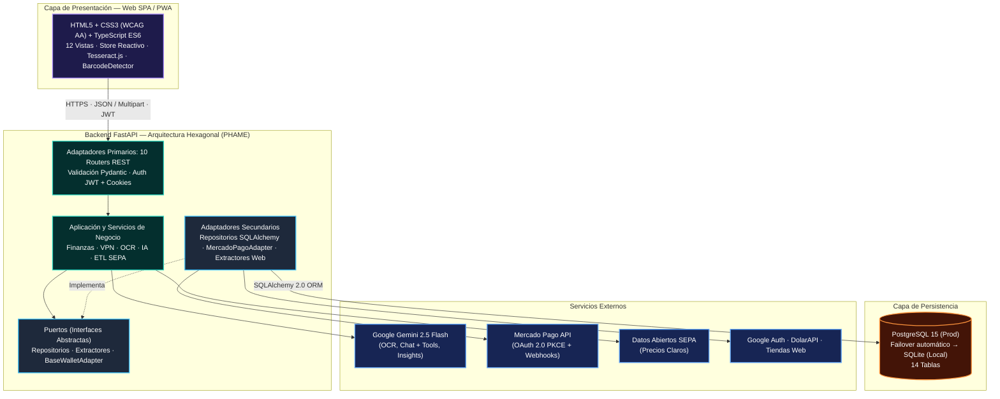
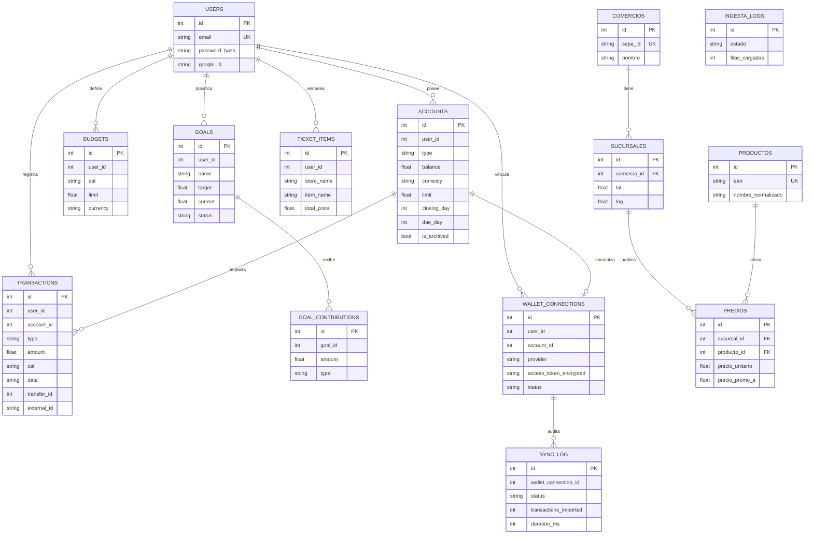
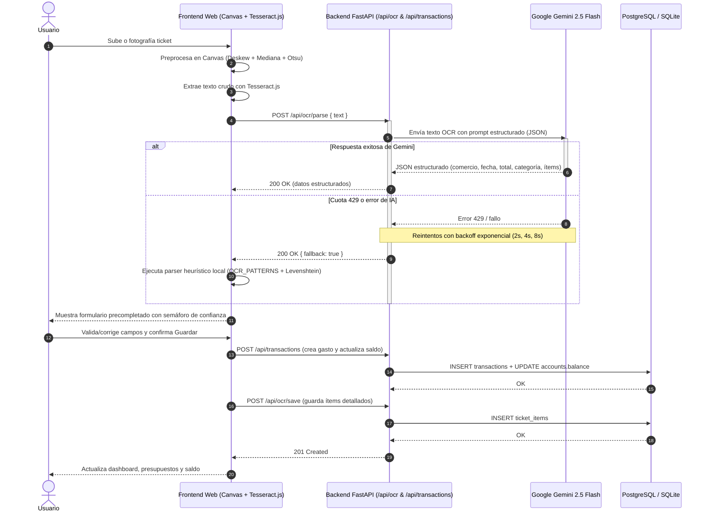
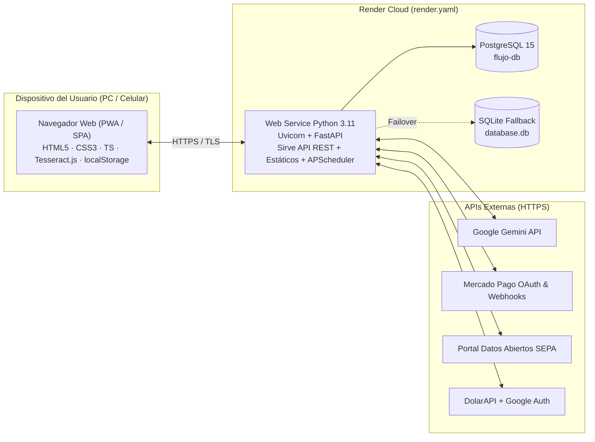

# Guía Completa para Exponer **Flujo Finance Manager**

> **Objetivo de esta guía:** que entiendas de punta a punta cómo funciona el proyecto mirando el código real (sin humo), que sepas exactamente qué te falta o qué corregir de los 5 diagramas que tenés en Google Drive, y que tengas un guion armado + respuestas listas para defenderlo frente a los profesores/jurado.

---

## 1. ¿Qué es este proyecto en palabras simples?

**Flujo** es una **aplicación web full-stack responsive (PWA)** de finanzas personales pensada para la realidad argentina (inflación, múltiples monedas, descuentos bancarios y dispersión de precios en supermercados).

A diferencia de una app común que solo sirve para anotar gastos a mano, Flujo combina **4 grandes bloques** en una sola web:

1. **Gestión financiera personal:** Dashboard con gráficos, Cuentas multidivisa (`ARS`, `USD`, `EUR`) con transferencias y conciliación de saldo, Transacciones, Presupuestos mensuales con alertas y Objetivos de ahorro.
2. **Escáner de tickets con OCR híbrido + IA:** Sacás foto a un ticket, la web la limpia y lee texto con **Tesseract.js**, y el backend la refina con **Google Gemini 2.5 Flash** devolviendo comercio, fecha, total, categoría e ítems (con respaldo local si falla la IA).
3. **Ahorro real al comprar:**
   - **Buscador de Supermercados (SEPA / Precios Claros):** descarga los precios oficiales del Estado, busca sucursales cerca tuyo por GPS (fórmula de Haversine), cruza promociones de tus tarjetas y te arma la **Compra Dividida (*Split Shopping*)** desde "Mi Lista del Súper".
   - **Asistente de Compras E-Commerce:** pegás el link de Mercado Libre o cualquier tienda online (o escaneás un código de barras) y calcula matemáticamente con **Valor Presente Neto (VPN)** y **TNA de Indiferencia** si te conviene pagar al contado o en cuotas según la inflación y el cierre de tu tarjeta.
4. **Automatización e Inteligencia Artificial:**
   - **Sincronización con Mercado Pago** usando **OAuth 2.0 + PKCE**, tokens cifrados con **Fernet** y **Webhooks con firma HMAC**.
   - **Chatbot financiero flotante e IA Insights** conectados a Gemini 2.5 Flash con **Function Calling** (puede consultar tus saldos reales y crear transacciones por vos desde el chat).

---

## 2. ¿Cómo está armado el código por dentro? (Sin marearte)

El proyecto tiene **dos grandes mitades** que viven en el mismo repositorio y se sirven juntas desde FastAPI:

### A. Frontend (lo que ve el usuario en el navegador)
- **`index.html`**: pantalla de inicio / login y registro (soporta mail+contraseña y Google Sign-In).
- **`main.html`**: la aplicación principal (SPA — *Single Page Application*, no recarga la página entera al cambiar de sección).
- **`html/views/`** (**12 vistas dinámicas**): `dashboard`, `transactions`, `budgets`, `cuentas`, `reportes`, `objetivos`, `scanner`, `insights`, `perfil`, `supermercados`, `shopping`, `lista_compras`. Se cargan todas en paralelo al iniciar (`js/app.ts -> loadViews()`).
- **`js/`** (TypeScript / ES6 modular):
  - `js/store/store.ts`: estado central de la app en memoria y soporte offline (`localStorage`).
  - `js/api/apiClient.ts` y `authApi.ts`: cliente HTTP unificado (`fetch`) que adjunta automáticamente el token JWT (`Authorization: Bearer ...`) y cookies de sesión.
  - `js/services/` (**12 servicios**): lógica del cliente separada de la interfaz (`transactionService`, `accountService`, `scannerService`, `sepaService`, `shoppingService`, `shoppingListService`, `chatService`, `cameraService`, etc.).
  - Controladores de vista (`accounts.ts`, `transactions.ts`, `budgets.ts`, `goals.ts`, `scanner.ts`, `supermercados.ts`, `shopping.ts`, `shoppingList.ts`, `reports.ts`, `ai.ts`, `profile.ts`) + `js/components/chatbot.ts`.
- **`css/`**: estilos modulares separados por base, layout, componentes, vistas (`css/views/*.css`) y accesibilidad (`css/accessibility.css` con criterios **WCAG 2.2 AA**).

### B. Backend (el servidor en Python dentro de `api/`)
Está organizado en **Arquitectura en Capas + Arquitectura Hexagonal (PHAME)** aplicando principios **SOLID**:

| Carpeta / Archivo | ¿Qué hace en criollo? |
| :--- | :--- |
| `api/main.py` | **Punto de entrada (*Composition Root*).** Arranca FastAPI, registra middlewares (CORS, sesiones, cabeceras de seguridad HTTP), monta las 10 rutas de la API, sirve los archivos estáticos (`/js`, `/css`, `/html`, `/data`), ejecuta migraciones/seed al inicio, prende el scheduler diario de SEPA y un *keep-alive* cada 14 min para que Render no se duerma. |
| `api/routers/` (**10 archivos**) | **Puerta de entrada HTTP.** Reciben requests, verifican autenticación (`get_current_user_id`), validan entrada con **Pydantic** (`api/schemas.py`) y delegan al servicio o caso de uso. Módulos: `auth`, `accounts`, `transactions`, `budgets`, `goals`, `wallets`, `ai`, `shopping`, `ocr`, `sepa`. |
| `api/application/use_cases/` | **Casos de uso** (`sepa_use_cases.py`, `auth_use_cases.py`) desacoplados de FastAPI y de SQLAlchemy. |
| `api/services/` | **Cerebro / Lógica de negocio:** cálculos de saldos, transferencias multidivisa, motor financiero VPN (`recommendation.py`), IA Gemini con *Function Calling* (`ai_service.py`), OCR (`ocr.py`), extractores de tiendas (`services/shopping/` con patrón *Strategy + Registry*), y pipeline ETL + comparador geográfico SEPA (`services/sepa/`). |
| `api/domain/` | **Núcleo de dominio:** entidades (`user.py`, `product.py`) y excepciones propias. |
| `api/ports/` | **Interfaces abstractas (Puertos):** contratos que definen *qué* se necesita de la base de datos o extractores sin acoplarse a una librería concreta (`account_repository_port.py`, `price_repository_port.py`, `product_extractor_port.py`, etc.). |
| `api/infrastructure/` | **Adaptadores de infraestructura:** implementación real de los repositorios en **SQLAlchemy** (`repositories/`), inyección de dependencias (`dependencies.py`) y migraciones incrementales (`migrations.py`). |
| `api/wallet_adapters/` | **Patrón Adapter para billeteras:** `base_adapter.py`, implementación real `mercadopago_adapter.py` (OAuth 2.0 + PKCE + normalización de pagos) y esqueletos preparados para `plaid_adapter.py` y `belvo_adapter.py`. |
| `api/models.py` y `api/database.py` | **Persistencia:** define las **14 tablas** en SQLAlchemy 2.0 y gestiona conexión a **PostgreSQL** en producción con **failover automático a SQLite** si PostgreSQL no responde. |
| `api/security.py` | **Seguridad:** hash de contraseñas con **bcrypt** (incluye dummy hash anti *timing attack*), generación/validación de **JWT (`HS256`)**, cookies firmadas y cifrado simétrico **Fernet (`AES-128-CBC + HMAC-SHA256`)** para tokens de billeteras. |
| `render.yaml` | **Infraestructura como Código (IaC):** despliegue automático del Web Service Python + base PostgreSQL 15 en Render. |

### C. ¿Cómo viaja una acción del usuario? (Ejemplo para contar en 20 segundos)
> *"Cuando el usuario carga un gasto, `js/transactions.ts` llama a `apiFetch('/api/transactions')` mandando su JWT. FastAPI lo recibe en `api/routers/transactions.py`, valida los tipos con Pydantic, se lo pasa a `TransactionService`, que usa los repositorios de Transacciones y Cuentas (inyectados por `dependencies.py`) para guardar el movimiento y actualizar el saldo de la cuenta en PostgreSQL/SQLite."*

---

## 3. Base de datos real: 14 tablas en 2 dominios (`api/models.py`)

### Dominio 1 — Finanzas Personales y Billeteras (9 tablas)
1. `users`: usuarios (email único, `password_hash` bcrypt, `google_id`, avatar).
2. `accounts`: cuentas y tarjetas (`type`, `bank`, `balance`, `currency` ARS/USD/EUR, `limit`, `closing_day`, `due_day`, `is_archived`, `is_favorite`, `cbu`, `alias`).
3. `transactions`: ingresos, gastos y transferencias (`user_id`, `account_id`, `type`, `desc`, `amount`, `cat`, `date`, `transfer_id`, `external_id` para evitar duplicados al sincronizar Mercado Pago).
4. `budgets`: presupuestos mensuales por categoría (`cat`, `limit`, `currency`).
5. `goals`: metas de ahorro (`name`, `target`, `current`, `deadline`, `currency`, `status`).
6. `goal_contributions`: aportes o retiros hechos a cada objetivo (`goal_id`, `amount`, `account_id`, `type`).
7. `ticket_items`: detalle línea por línea de los productos extraídos por OCR de cada ticket.
8. `wallet_connections`: vínculos OAuth con billeteras (`access_token_encrypted`, `refresh_token_encrypted`, `token_expires_at`, `status`).
9. `sync_log`: auditoría de cada sincronización con billeteras (importadas, saltadas, duración en ms, errores).

### Dominio 2 — Comparador de Supermercados SEPA (5 tablas)
10. `comercios`: cadenas de supermercados (`sepa_id`, `nombre`, `cuit`).
11. `sucursales`: locales físicos con coordenadas (`comercio_id` FK, `direccion`, `lat`, `lng` con índice compuesto).
12. `productos`: catálogo por código de barras (`ean` único, `nombre`, `nombre_normalizado`, `marca`, `categoria`).
13. `precios`: precio unitario y promos por sucursal+producto (`sucursal_id` FK, `producto_id` FK, `precio_unitario`, `precio_promo_a`, `precio_promo_b`, `fecha_vigencia`).
14. `ingesta_logs`: registro de cada corrida del ETL diario de SEPA (`estado`, `filas_procesadas`, `filas_cargadas`, `filas_error`).

---

## 4. Auditoría de tu documentación de Google Drive: ¿qué está bien y qué te falta?

Revisamos los **5 archivos que pasaste de Drive** uno por uno y los comparamos contra el código real del repositorio. Acá tenés el diagnóstico exacto para que **no te agarren en falso** en la exposición:

### 1) `Arquitectura por capas.svg` y `Diagrama de Arquitectura de Componentes.png`
- **❌ Error grave — Dicen "Flutter / Frontend Móvil":** ambos diagramas muestran *Cliente (Flutter / Web)* o directamente *Flutter App*. En el repositorio **no existe app Flutter**: todo es una **Web App Responsive (HTML5 + CSS3 + TypeScript/Vite)** servida por FastAPI. Si el jurado mira el código y el diagrama dice Flutter, te lo van a marcar seguro.
- **❌ Redundancia:** `Diagrama de Arquitectura de Componentes.png` muestra solo 3 bloques básicos (Flutter → FastAPI → PostgreSQL) y aporta menos información que `Arquitectura por capas.svg`. Te conviene reemplazarlo por un **Diagrama de Despliegue** o por el diagrama **Hexagonal (PHAME)**.
- **❌ Faltan servicios externos reales:** solo figura *Gemini 2.5 Flash*, pero tu backend se conecta a **5 sistemas externos**:
  1. **Google Gemini 2.5 Flash** (OCR semántico, Chatbot con *Function Calling*, IA Insights).
  2. **Mercado Pago API** (OAuth 2.0 + PKCE, descarga de pagos y Webhooks HMAC).
  3. **Datos Abiertos SEPA / Precios Claros** (ingesta diaria de ZIP/CSV con `APScheduler`).
  4. **Tiendas E-Commerce** (Mercado Libre + extractor genérico Schema.org/OpenGraph).
  5. **Google Sign-In & DolarAPI** (login OAuth y cotizaciones USD/EUR).
- **⚠️ Falta el failover de persistencia:** mostrar `PostgreSQL (Producción) + Fallback automático SQLite (Local)`.

### 2) `Modelo de Base de Datos (Entidad-Relación).png`
- **❌ Error visual:** los títulos de las tablas salen cortados en la imagen (`USUARIC`, `CATEGORI`, `TRANSACCIOI`).
- **❌ Entidades y campos que NO existen en el código:**
  - Muestra una tabla `CATEGORIA` (`id_categoria`, `nombre_rubro`, `metadatos_ocr`) y un campo `preferencias_ia` en `USUARIO`. En `api/models.py` **eso no existe**: la categoría se guarda como texto (`cat`) en `transactions`, `budgets` y `goals`.
- **❌ Falta la relación `CUENTA` → `TRANSACCION`** (`account_id`) en la imagen de Drive.
- **❌ Faltan 11 de las 14 tablas reales:** solo muestra 3 tablas reales (`users`, `accounts`, `transactions`), pero faltan `budgets`, `goals`, `goal_contributions`, `ticket_items`, `wallet_connections`, `sync_log` y las 5 tablas de SEPA (`comercios`, `sucursales`, `productos`, `precios`, `ingesta_logs`).
- **💡 Dato técnico honesto por si preguntan:** en `api/models.py`, las tablas SEPA tienen `ForeignKey(...)` explícitas en SQL, mientras que las tablas de finanzas relacionan `user_id`/`account_id`/`goal_id` por índice entero a nivel aplicación (esto se puede mencionar como punto de mejora en futuras migraciones Alembic).

### 3) `Secuencia registro de gasto con OCR.svg`
- **✅ Lo bueno:** está muy bien planteado el bloque `alt` con el reintento por backoff exponencial (`2s, 4s, 8s`) y fallback local ante HTTP 429 de Gemini (eso SÍ está en `api/services/ai_service.py`!).
- **❌ Endpoint y formato desactualizados:** dice `POST /transacciones/ocr (imagen Base64)`, cuando en el código real hay **dos flujos**:
  - **Flujo principal de la app (`js/scanner.ts` + `js/services/scannerService.ts`):** preprocesa la imagen en Canvas (escala de grises, corrección de inclinación *deskew*, filtro de mediana y umbralización de **Otsu**), extrae el texto en el navegador con **Tesseract.js**, envía ese texto a **`POST /api/ocr/parse`** (Gemini 2.5 Flash) y muestra el formulario con **semáforo de confianza** para que el usuario valide antes de guardar.
  - **Flujo alternativo de imagen directa (`api/routers/ocr.py`):** **`POST /api/ocr/scan-ticket`** recibe un archivo `multipart/form-data` (PNG/JPG, no Base64) y devuelve la lista de ítems en JSON.
- **❌ Momento del guardado incorrecto:** el diagrama muestra que el backend hace `INSERT` automático apenas responde la IA y devuelve `201 Created`. En el código real **no guarda automáticamente**: primero el usuario revisa/corrige el formulario precompletado y recién al confirmar se llaman `POST /api/transactions` (crea el gasto y actualiza el saldo) y `POST /api/ocr/save` (guarda los `ticket_items`).
- **❌ Respuesta en fallback:** ante fallo o cuota agotada de Gemini, `/api/ocr/parse` no devuelve HTTP `422`, sino JSON `{"fallback": true, "error": "..."}` para que el frontend use sin cortes su propio parser heurístico local.

### 4) `uml_use_case_gastos_v2.svg`
- **✅ Lo bueno:** la notación UML estándar (system boundary, actores, elipses, `«include»`, `«extend»` y leyenda) está prolija y académicamente correcta.
- **❌ Caso de uso inexistente en el código:** incluye **"Escanear folleto"** (`«extend»` de Comparar precios). Eso **no está implementado**: lo que sí tenés implementado es **Escanear código de barras (EAN-13)** y **Optimizar lista de compras (*Split Shopping*)**.
- **❌ Le falta más de la mitad del sistema real:** no aparecen:
  - Gestionar cuentas multidivisa y transferencias (`ARS`/`USD`/`EUR`)
  - Gestionar presupuestos y objetivos de ahorro
  - Simular compras E-Commerce (VPN cuotas vs. contado)
  - Sincronizar billeteras virtuales (Mercado Pago OAuth 2.0)
  - Consultar Chatbot IA e IA Insights
  - Actores externos: **API Gemini (IA/OCR)**, **API Mercado Pago**, **Datos Abiertos SEPA**, **Google OAuth**.

### 5) ¿Qué documentación o detalles extras te faltan para cerrar 10/10?
1. **Diagrama de Despliegue (Deployment):** no tenés ninguno en Drive. Abajo ya te lo dejamos armado en Mermaid listo para exportar.
2. **Actualizar los 4 diagramas de Drive** con las versiones corregidas de la sección 5 de esta guía (así coinciden 100% con el código y con el `Documento de Visión v3.0`).
3. **Limpiar el repositorio antes de entregar/mostrar en pantalla:**
   - Hay un archivo **`LEGO Island Spanish.7z` (273 MB)** suelto en la raíz del proyecto que claramente no pertenece al trabajo.
   - También hay scripts temporales de refactor/generación en la raíz (`patch_accounts.py`, `refactor.js`, `gen.ps1`, `gen_artifact.py`) y en `package.json` la descripción todavía dice *"App Móvil (Flutter)"*.
4. **Plan B para la demo:** tener 4 o 5 capturas de pantalla (o un video corto de 1 minuto) por si el Wi-Fi del aula falla, Render tarda en despertar o Gemini devuelve 429 justo en vivo.
5. **Conocer tus puntos pendientes honestos (los jurados valoran mucho la autocrítica):**
   - Tests automáticos (`api/tests/`): hay 5 suites (`accounts`, `budgets`, `goals`, `recommendation`, `sepa`), pero faltan tests para `auth`, `transactions`, `ocr`, `ai` y `wallets`.
   - Deuda técnica (`reporte_metricas.md`): algunos archivos del frontend (`accounts.ts`, `shopping.ts`, `scannerService.ts`) todavía son grandes y están en roadmap de refactorización.
   - Accesibilidad (`mds/accesibilidad.md`): se aplicó WCAG 2.2 AA en Lista de Compras y SEPA; queda pendiente extenderla al resto de las vistas.

---

## 5. Diagramas Mermaid corregidos (100% fieles al código real)

Podés copiar cualquiera de estos bloques en [mermaid.live](https://mermaid.live) y exportarlos a SVG/PNG para reemplazar los de Drive.

### 5.1 Arquitectura Real (Capas + Hexagonal PHAME)

### 5.2 Modelo Entidad-Relación Real (14 tablas)

### 5.3 Secuencia Real: Registro de Gasto con OCR Híbrido

### 5.4 Diagrama de Despliegue (Faltante en Drive)

---

## 6. Guion sugerido de Demo en Vivo (3 minutos)

1. **Login + Dashboard (30 seg):** mostrar ingreso, resumen patrimonial multidivisa y gráficos.
2. **Cuentas + Transferencia o Conciliación (30 seg):** explicar tipos de cuenta (efectivo, banco, tarjeta con cierre/vencimiento, Mercado Pago) y archivado sin borrar historial.
3. **Escáner OCR (45 seg):** subir uno de los tickets de prueba (`tests/tickets/`), mostrar cómo preprocesa, devuelve el formulario con niveles de confianza y carga el gasto.
4. **Buscador SEPA + Mi Lista del Súper (45 seg):** buscar un producto común (ej. leche o yerba), mostrar precios por cercanía y el botón de **Compra Dividida** en la lista.
5. **Asistente E-Commerce + Chatbot IA (30 seg):** simular un precio en cuotas vs. contado mostrando el VPN / opción ganadora, y hacerle una pregunta rápida al chatbot flotante (ej. *"¿Cuánto saldo tengo disponible?"*).

---

## 7. Preguntas difíciles que te pueden hacer (y cómo responderlas)

| Pregunta del jurado | Respuesta clara y segura |
| :--- | :--- |
| **¿Por qué usan Web + TypeScript y no una app móvil nativa/Flutter?** | Porque una **Web App Responsive (PWA)** corre instantáneamente en celular y PC sin pasar por tiendas ni duplicar código, y hoy los navegadores ya nos dan acceso directo a cámara, `Canvas`, `Tesseract.js` y `BarcodeDetector`. |
| **¿Por qué el OCR es "híbrido" en vez de mandarle siempre la foto cruda a la IA?** | Porque si la API de Gemini se satura (error 429) o no hay API key, el sistema igual funciona con **Tesseract.js + parser heurístico local**. Además, el preprocesamiento en Canvas (deskew + Otsu) mejora la lectura y el usuario siempre valida antes de guardar para no meter errores en su contabilidad. |
| **¿Cómo evitan que se cuelgue la app buscando precios en los archivos gigantes de SEPA?** | Nunca consultamos los CSV del gobierno en tiempo real cuando busca el usuario. Un **pipeline ETL** (`APScheduler` + Pandas) descarga el ZIP, limpia y normaliza los datos en segundo plano y los deja indexados en nuestras 5 tablas SEPA con índice por `lat/lng` y `ean`. |
| **¿Cómo calculan si convienen cuotas o contado?** | En `api/services/recommendation.py` calculamos el **Valor Presente Neto (VPN)** descontando cada cuota futura con la tasa diaria equivalente a la TNA de inflación/rendimiento, sumando además los **días de gracia reales** según el día de cierre y vencimiento de la tarjeta. Y si hay recargo, calculamos por bisección la **TNA de indiferencia** (a partir de qué tasa te empieza a convenir financiar). |
| **¿Cómo protegen los tokens de Mercado Pago y las contraseñas?** | Las contraseñas se hashean con **bcrypt** (nunca texto plano) y usamos un dummy hash para evitar *timing attacks*. Los tokens OAuth de Mercado Pago se obtienen con **PKCE**, se cifran en reposo con **Fernet (AES-128 + HMAC-SHA256)** usando `ENCRYPTION_KEY`, y los webhooks se validan con firma **HMAC-SHA256**. Además, la API key de Gemini vive solo en el servidor. |
| **¿Qué pasa si se cae PostgreSQL en Render o no hay internet?** | En `api/database.py` implementamos un **failover automático**: al arrancar prueba `SELECT 1` contra PostgreSQL y si falla conmuta a SQLite local sin tumbar el servidor. En Render además corre un *keep-alive* cada 14 minutos contra `/health`. Y en el cliente tenemos almacenamiento de respaldo en `localStorage`. |
| **¿Por qué dicen Arquitectura Hexagonal (PHAME) y SOLID?** | Porque separamos las rutas HTTP (`routers`), la lógica de negocio (`services`/`use_cases`), las interfaces (`ports`) y los accesos a datos o servicios externos (`infrastructure/repositories` y `wallet_adapters`). Por ejemplo, para sumar otra billetera además de Mercado Pago solo implementamos `BaseWalletAdapter` sin tocar el resto del sistema (Principio Abierto/Cerrado). |
| **¿Qué mejoras pendientes reconocen en el proyecto?** | Tres muy concretas: ampliar la cobertura de tests `pytest` a módulos como `auth` y `ai`, terminar de dividir los archivos grandes del frontend detectados en nuestro reporte de métricas (`accounts.ts`, `shopping.ts`), y completar la auditoría WCAG 2.2 AA en todas las vistas (ya aplicada en Lista de Compras y SEPA). |
