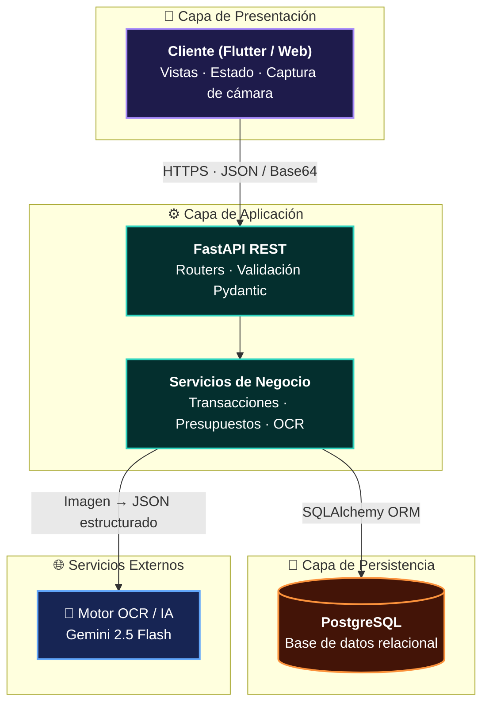
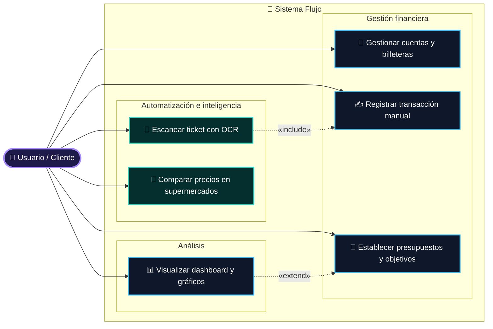
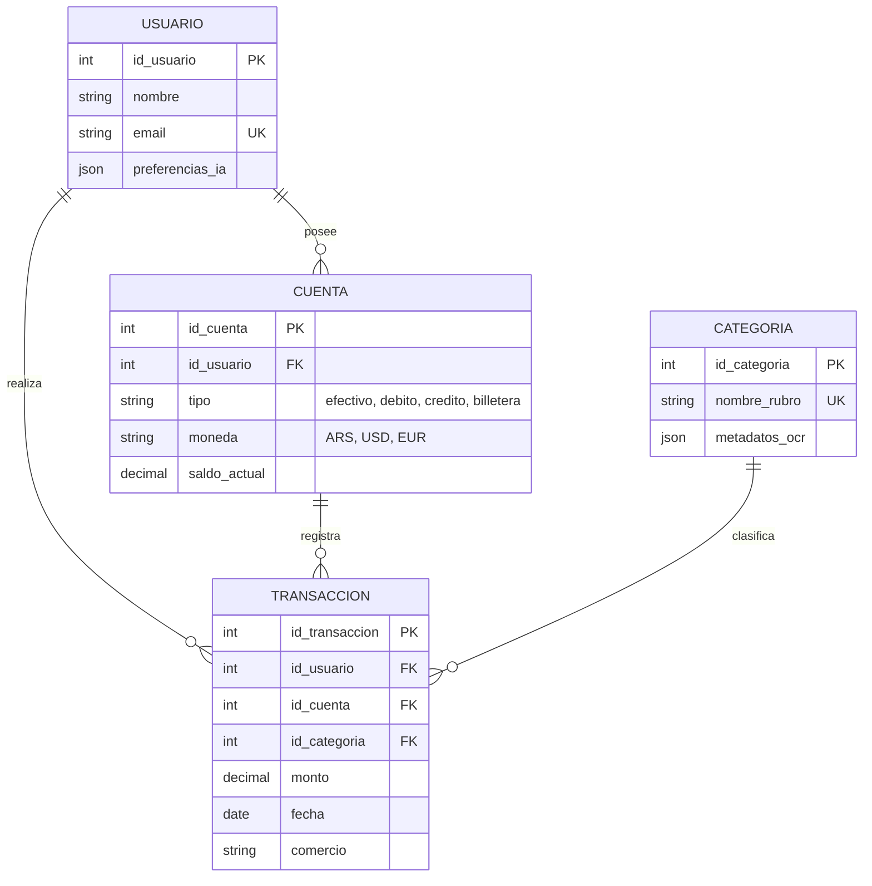
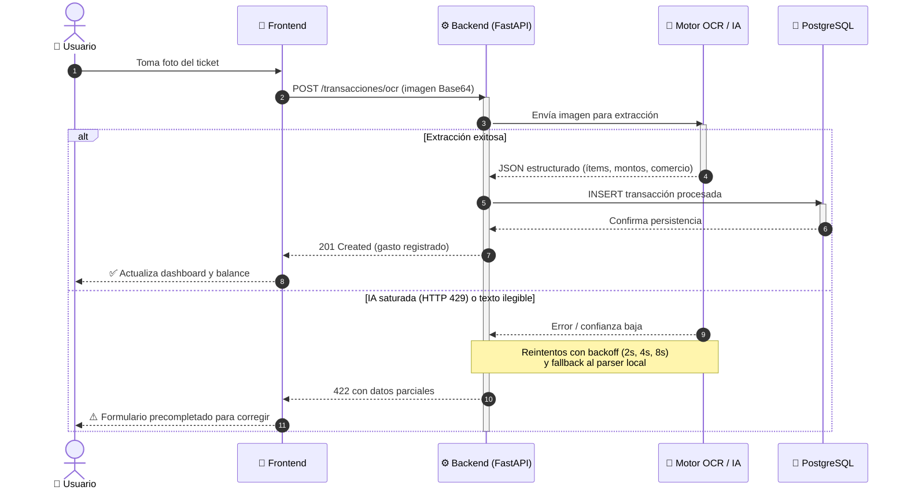

# Diagramas de Arquitectura Mejorados — Flujo

Versión mejorada de los 4 diagramas Mermaid (arquitectura, casos de uso, ER y secuencia OCR).
Mejoras generales: colores semánticos por capa (`classDef`), íconos, etiquetas completas (sin texto cortado), numeración de pasos y rutas de error.

---

## 1. Arquitectura por capas

---

## 2. Casos de uso del sistema

---

## 3. Modelo Entidad–Relación

> Se agregó `id_cuenta` (FK) en `TRANSACCION` y la relación `CUENTA ─ registra ─ TRANSACCION`, que faltaba.
> Se completaron tipos (`decimal` para dinero, `timestamp`) y restricciones `UK`.

---

## 4. Secuencia: registro de gasto con OCR

